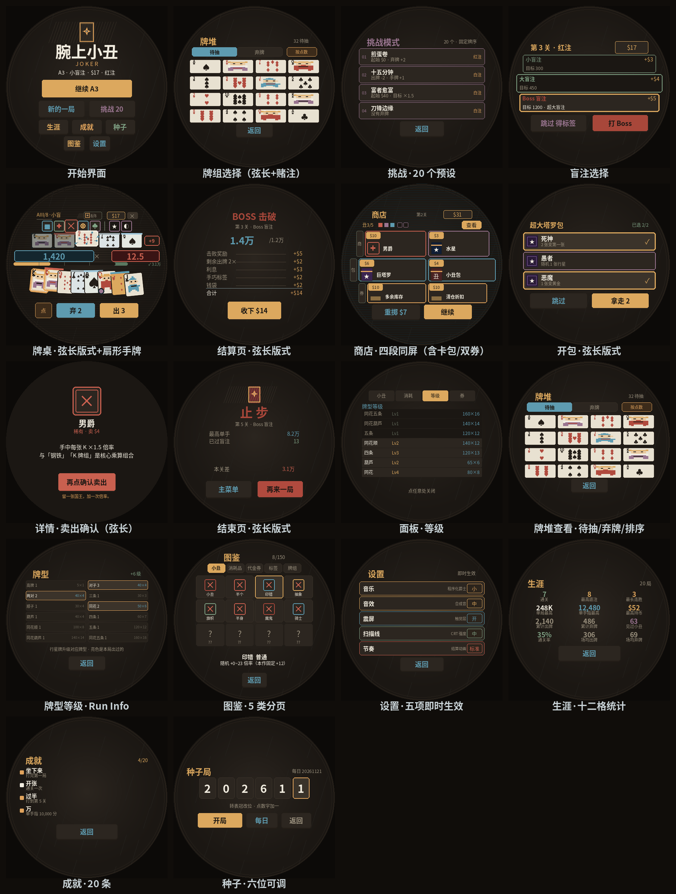
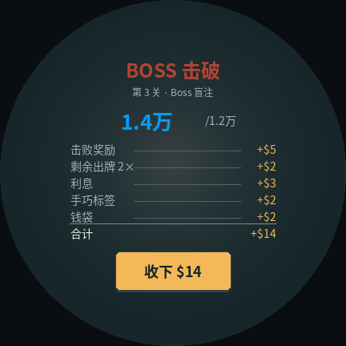
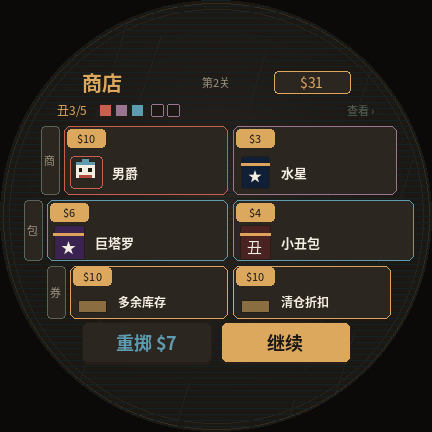
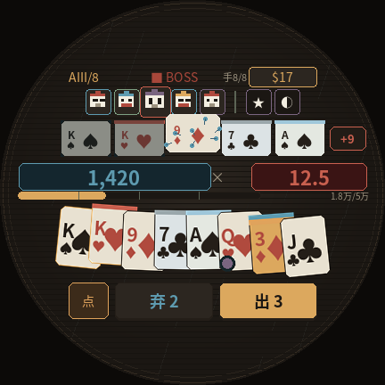
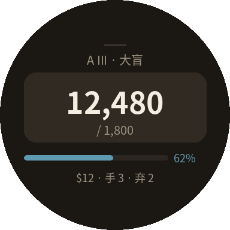
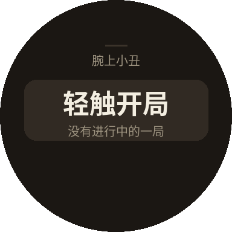
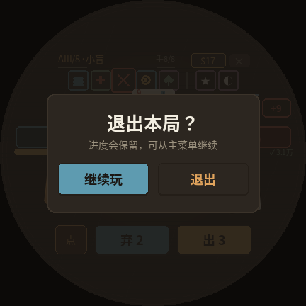
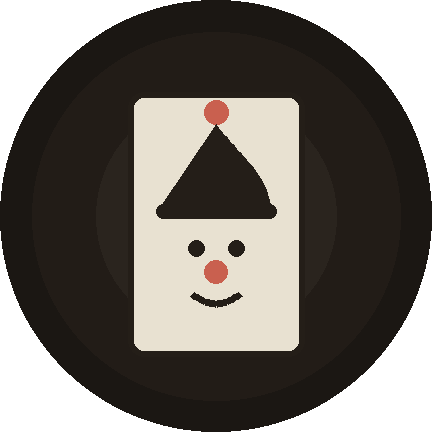

# 腕上小丑 · WristJoker

> 把《Balatro（小丑牌）》的完整流程搬进 Wear OS 圆屏：Kotlin + Compose for Wear OS 原生重写，不是手机版套壳，也不是网页套 WebView。



---

## 这是什么

一块 1.3 英寸、432×432 的圆形屏幕，能放下的东西比想象中少：一屏最多三行字、七八张牌。这个项目做的事情，是把「选牌 → 出牌计分 → 达标结算 → 商店构筑 → 下一关」这套循环重新排进圆里，而不是把矩形界面裁成圆形。

- **纯原生**：Kotlin + Jetpack Compose（Wear Compose 1.5.0），单 Activity，无 WebView、无游戏引擎。
- **逻辑与渲染分离**：`game/` 是纯 Kotlin（无 Android 依赖），可以在 JVM 上直接跑单测；`ui/` 只负责画和收手势。
- **离线可玩**：无网络权限，存档落在本地 `SharedPreferences` 的行式文本里。

## 能玩到什么

| 环节 | 实现 |
| --- | --- |
| 一局流程 | 8 个底注 × 3 个盲注（小盲 / 大盲 / Boss），Boss 28 种副作用，达标后进商店 |
| 手牌 | 8 张起手，可拖拽换位、可一键按点数/花色排序；12 种牌型（含五条 / 同花葫芦 / 同花五条），支持四指、捷径、涂抹等特殊判定 |
| 牌面改造 | 6 种增强（奖励 / 倍率 / 万能 / 玻璃 / 钢铁 / 石头）、4 种蜡封（红 / 金 / 蓝 / 紫）、4 种版本（箔 / 全息 / 多彩 / 负片） |
| 构筑 | 150 张小丑、52 张消耗品（22 塔罗 + 12 行星 + 18 幻灵）、32 张代金券、24 种标签 |
| 商店 | 四段结构：小丑 / 补充包 / 代金券 / 重掷；商品可长按看详情，出售有二次确认 |
| 难度 | 8 档赌注逐档叠加并逐档解锁；20 个固定种子挑战 |
| 信息 | 牌堆查看（待抽 / 弃牌，按摸牌顺序摊开）、牌型等级总览（12 种牌型的当前筹码×倍率） |
| 周边 | 图鉴（5 类分页）、设置（音乐 / 音效 / 震动 / 扫描线 / 结算速度）、局内退出、自动存档续局 |
| 卡片 | 手表卡片（Tile）：抬手一滑看到当前底注、分数 / 目标与剩余出牌，轻触回牌桌 |
| 声音 | 代码合成的 8 小节爵士循环（贝斯 / 电钢 / 鼓刷 / 黑胶底噪），随场景改速度；14 种合成音效 |

## 圆屏不是切一刀

很多「圆屏适配」是把方形布局塞进圆形安全区，四角留白，中间一块方的。这里用的是**弦长版式**：

每一条横向内容带的宽度，取该带上下沿中离圆心更远那条边的弦长：

```
w = 2√(r² − dy²)      r = 108 − 9 = 99dp（留 9dp 呼吸位）
```

于是越靠上的行越窄、越靠中间的行越宽，内容贴着圆的轮廓生长。15 个界面全部由同一份骨架（`ui/RoundPage.kt`）驱动，每个界面只声明一组「带高 + 间距」的纯数据。

`tools/verify_circle.py` 会按同样公式把 15 个界面各画一遍，检查四角是否越界：当前最远内容角落在 **99.0dp**，阈值 104dp。即便把每行高度整体 +1/+2/+3dp，仍然 PASS。

| 菜单 | 结算 | 商店 |
| --- | --- | --- |
|  |  |  |

| 出牌 | 图鉴 | 设置 |
| --- | --- | --- |
|  |  |  |

## 声音不是配乐，是节奏

原作的氛围有一半来自那支循环的爵士小乐队。这里没有打包任何音频：
`fx/Music.kt` 用代码合成 8 小节（92 BPM，摇摆八分）的循环 —— 走路贝斯、反拍电钢、
鼓刷、黑胶底噪，写成 22kHz 单声道 WAV 放在 `cacheDir`，交给 `MediaPlayer` 循环。

场景切换只改播放速度，不换曲：菜单与牌桌 1.0，Boss 0.94（沉下来），结算与商店 1.06（轻快）。
循环点用"多渲 1.2 小节、尾巴折回开头"处理，听不出接缝。

手牌也不是瞬间出现的：新牌从下方 20dp 带 9° 倾角落下，按位置错峰 42ms，
五张牌是 0.17 秒的"唰唰唰"，和发牌音效对得上。

## 视觉：用 1999 的印刷底，装 Balatro 的信息

这不是"把界面涂成咖啡色"。迁移只换了几层，其余锁死（方法论见 `reverse1999-design/DESIGN_LANGUAGE.md` §5：只换少数维度）：

| 维度 | 处理 |
| --- | --- |
| 底色 / 影调 | 换成深咖低长调（`ink-900`），赌桌墨绿退成辅助色 |
| 材质 | 纸张纤维短划、油墨黑描边、装订边双线、牌面四角做旧 |
| 装饰 | 四角星（点击态）、罗马数字（底注显示为 `AIII/8`）、雨滴斜线 |
| 字体 | 大号数字与标题走衬线（Didot 气质），小字仍用无衬线保可读 |
| **功能色** | **语义锁死**：蓝=筹码、红=倍率、金=金钱；只降饱和、统一泛黄 |

最后一行是纪律。1999 的「80% 面积低饱和」不能套到数值色上 —— 玩家靠颜色一眼读"这是筹码还是倍率"，一起灰掉等于用风格换掉可玩性。

具体落到三处：

- **牌背**从 Bicycle 红斜网换成深咖 + 烫金双线 + 四角星；
- **牌面**加四角老化与双线压印框（网点试过，25dp 高的牌上会糊成脏）；
- **光标**从四角 L 线换成四角星。

所有图形仍是 Canvas 代码绘制，APK 里没有一张位图（唯一的位图是卡片的系统缩略图）。

## 抬腕就看一眼：手表卡片

一局要打十几分钟，但手表的交互是"看一眼就走"。想知道「还差多少分、还剩几次出牌」，之前得重新打开 App —— 冷启动、读存档、进牌桌，三秒起步，还容易被别的事打断。所以补了一张卡片（Wear OS 叫 Tile，就是三星手表「添加卡片」列表里的那一类）：

| 牌桌 | 没有进行中的一局 |
| --- | --- |
|  |  |

三条约束：

- **不建引擎**。`TileService` 是系统按需绑定的短命服务，为了四行字把 52 张牌和整个商店还原一遍没有意义；卡片直接读 `SaveCodec` 解出来的存档（为此存档多存了一行目标分，旧档缺这行时退化成只显示分数）。
- **不做交互**。整块可点，回到游戏。Wear OS 会把点击区放大到 48dp 以上，卡片上再放两个小按钮只会互相误触 —— 出牌本来就该在牌桌上完成。
- **只用语义色**。进度条是筹码蓝、Boss 标题是砖红，其余走纸白与暖灰。这是"瞟一眼"的场景，颜色越多越读不出重点。

状态一变就主动叫醒卡片（节流 2 秒，离场时强制刷一次），不必等系统一分钟一次的 freshness 轮询。

## 手指比圆小得多

1.3 英寸的屏幕上，一根手指落下就是 40dp 见方 —— 比两张牌横着摆还宽。
这一轮按"误触从哪来"改了三处：

| 问题 | 改法 |
| --- | --- |
| 点相邻两张牌的交界，选中的是右边那张 | 每张牌不再各自接点击；整条手牌带只挂一个手势，按"离哪张牌的中心最近"判定。边界正好落在两张牌中间，与视觉一致 |
| 想点「出牌」却碰到手牌 | 手牌带 42→40dp，与按钮的间距 3→8dp；出牌区 24→22dp 让出这 5dp |
| 「出牌」与「弃牌」只隔 4dp | 拉开到 6dp。宁可两边都不响，也不能点"出"却弃了牌 |

局内退出也补上了：顶栏最右一个 14dp 的 ×，点开是确认层。退出前先把进度落盘，
回到主菜单后主按钮变成「继续 A3」，点进去还是刚才那张牌桌 —— 包括手牌、
分数、Boss 效果和商店里的货。



## 图标

深咖底上的一张牌，牌面一顶软塌的小丑帽，帽尖那颗红球是唯一的暖色。
不用小丑脸：48dp 下五官会糊成一团黑点，而牌形的轮廓在任何尺寸都成立。

单色（主题图标）版本把帽子**挖空**：前景版靠"纸色牌面 + 深咖帽子"的明度差
讲内容，被系统换成单一色之后帽子会与牌面融成一整块方块。

| 432px | 48px |
| --- | --- |
|  |  |

## 安装

```bash
# 手表开启开发者调试（无线调试或 USB），确认 adb 能看到设备
adb devices
adb install -r dist/wristjoker.apk
```

装好后在手表上添加卡片：**表盘向右滑到底 → 「添加卡片」→ 选「小丑牌局」**。
（三星手表也可以从手机端的 Galaxy Wearable → 卡片 里编辑顺序。）

`dist/wristjoker.apk` 是 debug 签名的 release 包（23,323,103 字节，SHA256 `8fc220c9…f99f`），仅用于侧载验证；要正式分发请换成自己的签名。

## 构建

需要 **JDK 17** 与 **Android SDK Platform 36**（`compileSdk 36`，`minSdk 30`，`targetSdk 34` 对齐 Galaxy Watch7 出厂系统）。

```bash
# 183 个 JVM 单元测试（纯逻辑，不需要模拟器）
./gradlew :app:testDebugUnitTest

# 生成 release APK
./gradlew :app:assembleRelease
```

`gradle.properties` 里的 `org.gradle.java.home` 指向本机的 JDK 17 路径，换机器时改成自己的，或直接删掉让 Gradle 用 `JAVA_HOME`。

依赖版本刻意锁在 2025 年中的稳定组合：2026 年的新 androidx 库要求 `compileSdk 37` + AGP 9.1+，与 API 36 工具链硬冲突。

## 验证

| 项 | 结果 |
| --- | --- |
| 单元测试 | 183 个用例全通过（牌型边界、计分顺序、Boss 副作用、存档往返、内容量断言、圆弦几何、卡片文案映射、退出续局） |
| 界面几何 | 15 个界面四角均不越界，最远 99.0dp / 阈值 104dp |
| 卡片 | 服务已合入 APK 清单（`BIND_TILE_PROVIDER` + PREVIEW 缩略图），文案映射 8 个用例覆盖；渲染未在真机卡片列表里走过 |
| 产物 | `assembleRelease` 成功，APK 可解析安装 |

详细过程与踩坑记录见 [`docs/verify-report.md`](docs/verify-report.md)，玩法与原作的逐项对照见 [`docs/BALATRO_PORT.md`](docs/BALATRO_PORT.md)。

## 目录

```
app/src/main/java/com/wearos/wristjoker/
├── game/          纯 Kotlin 规则层：牌、牌型、计分、小丑、消耗品、券、标签、赌注、挑战、存档编解码
├── ui/            Compose 界面：圆弦骨架、15 个页面、卡牌控件、面板、图鉴、设置
├── tile/          手表卡片：TileService、存档→文案映射、刷新节流
├── fx/            声音：合成音效、程序化爵士循环、震动
├── SaveStore.kt   本地存档 / 设置 / 解锁进度
└── MainActivity.kt 导航与状态宿主
app/src/test/      183 个 JVM 单测
tools/             圆屏几何校验、15 屏预览渲染、卡片缩略图、图标预览
preview/           预览图
dist/              发行 APK
docs/              移植笔记与验证报告
```

## 已知限制

- 只在**桌面预览与几何校验**层面验证过，尚未在真机（Galaxy Watch7）上跑手感。
- 卡片（Tile）已在清单里注册、文案有单测，但没在真机的「添加卡片」列表里实际加过一张 —— protolayout 的渲染只能靠真机或 Wear 模拟器确认。
- 图鉴目前只有「见过 / 没见过」两态，没有原作的成就式解锁条件。
- 8 档赌注实现了规则差异，但没做原作每档的贴纸与 Boss 池调整。
- 挑战模式的 20 条规则是参数化改写；原版依赖隐藏计数器的少数条目，用常驻 Boss 或目标倍率近似。

## 声明

非官方同人项目，仅供学习与个人使用。《Balatro》版权归 LocalThunk / Playstack 所有。

本仓库**不包含**原作的任何美术、音频或代码资源：牌面、小丑头像、图标全部由 Compose Canvas 用代码绘制，音效由代码合成 PCM 后经 `SoundPool` 播放。

未附开源许可证，如需复用请先联系作者。
