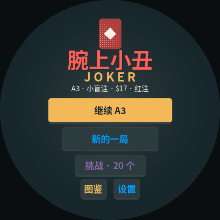
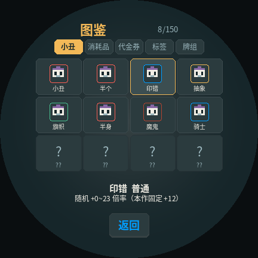
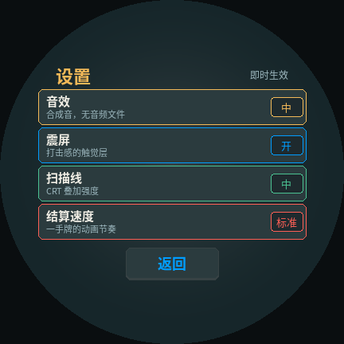

# 腕上小丑 · WristJoker

> 把《Balatro（小丑牌）》的完整流程搬进 Wear OS 圆屏：Kotlin + Compose for Wear OS 原生重写，不是手机版套壳，也不是网页套 WebView。


---

## 这是什么

一块 1.3 英寸、432×432 的圆形屏幕，能放下的东西比想象中少：一屏最多三行字、七八张牌。这个项目做的事情，是把「选牌 → 出牌计分 → 达标结算 → 商店构筑 → 下一关」这套循环重新排进圆里，而不是把矩形界面裁成圆形。

- **纯原生**：Kotlin + Jetpack Compose（Wear Compose 1.5.0），单 Activity，无 WebView、无游戏引擎。
- **逻辑与渲染分离**：`game/` 是纯 Kotlin（无 Android 依赖），可以在 JVM 上直接跑单测；`ui/` 只负责画和收手势。
- **离线可玩**：无网络权限，存档落在本地 `SharedPreferences` 的行式文本里。

## 能玩到什么

| 环节 | 实现 |
| --- | --- |
| 一局流程 | 8 个底注 × 3 个盲注（小盲 / 大盲 / Boss），Boss 28 种副作用，达标后进商店 |
| 手牌 | 8 张起手，可拖拽换位；支持同花 / 顺子 / 葫芦 / 四条等 13 种牌型，含四指、捷径、涂抹等特殊判定 |
| 牌面改造 | 6 种增强（奖励 / 倍率 / 万能 / 玻璃 / 钢铁 / 石头）、4 种蜡封（红 / 金 / 蓝 / 紫）、4 种版本（箔 / 全息 / 多彩 / 负片） |
| 构筑 | 150 张小丑、52 张消耗品（22 塔罗 + 12 行星 + 18 幻灵）、32 张代金券、24 种标签 |
| 商店 | 四段结构：小丑 / 补充包 / 代金券 / 重掷；商品可长按看详情，出售有二次确认 |
| 难度 | 8 档赌注逐档叠加并逐档解锁；20 个固定种子挑战 |
| 周边 | 图鉴（5 类分页）、设置（音效 / 震动 / 扫描线 / 结算速度）、自动存档续局 |

## 圆屏不是切一刀

很多「圆屏适配」是把方形布局塞进圆形安全区，四角留白，中间一块方的。这里用的是**弦长版式**：

每一条横向内容带的宽度，取该带上下沿中离圆心更远那条边的弦长：

```
w = 2√(r² − dy²)      r = 108 − 9 = 99dp（留 9dp 呼吸位）
```

于是越靠上的行越窄、越靠中间的行越宽，内容贴着圆的轮廓生长。13 个界面全部由同一份骨架（`ui/RoundPage.kt`）驱动，每个界面只声明一组「带高 + 间距」的纯数据。

`tools/verify_circle.py` 会按同样公式把 13 个界面各画一遍，检查四角是否越界：当前最远内容角落在 **99.0dp**，阈值 104dp。即便把每行高度整体 +1/+2/+3dp，仍然 PASS。

| 菜单 | 结算 | 商店 |
| --- | --- | --- |
|  |  |  |

| 出牌 | 图鉴 | 设置 |
| --- | --- | --- |
|  |  |  |

## 安装

```bash
# 手表开启开发者调试（无线调试或 USB），确认 adb 能看到设备
adb devices
adb install -r dist/wristjoker.apk
```

`dist/wristjoker.apk` 是 debug 签名的 release 包（20,483,820 字节，SHA256 `74e0698f…fe441`），仅用于侧载验证；要正式分发请换成自己的签名。

## 构建

需要 **JDK 17** 与 **Android SDK Platform 36**（`compileSdk 36`，`minSdk 30`，`targetSdk 34` 对齐 Galaxy Watch7 出厂系统）。

```bash
# 142 个 JVM 单元测试（纯逻辑，不需要模拟器）
./gradlew :app:testDebugUnitTest

# 生成 release APK
./gradlew :app:assembleRelease
```

`gradle.properties` 里的 `org.gradle.java.home` 指向本机的 JDK 17 路径，换机器时改成自己的，或直接删掉让 Gradle 用 `JAVA_HOME`。

依赖版本刻意锁在 2025 年中的稳定组合：2026 年的新 androidx 库要求 `compileSdk 37` + AGP 9.1+，与 API 36 工具链硬冲突。

## 验证

| 项 | 结果 |
| --- | --- |
| 单元测试 | 142 个用例全通过（牌型边界、计分顺序、Boss 副作用、存档往返、内容量断言、圆弦几何） |
| 界面几何 | 13 个界面四角均不越界，最远 99.0dp / 阈值 104dp |
| 产物 | `assembleRelease` 成功，APK 可解析安装 |

详细过程与踩坑记录见 [`docs/verify-report.md`](docs/verify-report.md)，玩法与原作的逐项对照见 [`docs/BALATRO_PORT.md`](docs/BALATRO_PORT.md)。

## 目录

```
app/src/main/java/com/wearos/wristjoker/
├── game/          纯 Kotlin 规则层：牌、牌型、计分、小丑、消耗品、券、标签、赌注、挑战、存档编解码
├── ui/            Compose 界面：圆弦骨架、13 个页面、卡牌控件、面板、图鉴、设置
├── fx/            音效与震动反馈
├── SaveStore.kt   本地存档 / 设置 / 解锁进度
└── MainActivity.kt 导航与状态宿主
app/src/test/      142 个 JVM 单测
tools/             圆屏几何校验、13 屏预览渲染
preview/           预览图
dist/              发行 APK
docs/              移植笔记与验证报告
```

## 已知限制

- 只在**桌面预览与几何校验**层面验证过，尚未在真机（Galaxy Watch7）上跑手感。
- 图鉴目前只有「见过 / 没见过」两态，没有原作的成就式解锁条件。
- 8 档赌注实现了规则差异，但没做原作每档的贴纸与 Boss 池调整。
- 挑战模式的 20 条规则是参数化改写；原版依赖隐藏计数器的少数条目，用常驻 Boss 或目标倍率近似。

## 声明

非官方同人项目，仅供学习与个人使用。《Balatro》版权归 LocalThunk / Playstack 所有。

本仓库**不包含**原作的任何美术、音频或代码资源：牌面、小丑头像、图标全部由 Compose Canvas 用代码绘制，音效由代码合成 PCM 后经 `SoundPool` 播放。

未附开源许可证，如需复用请先联系作者。
