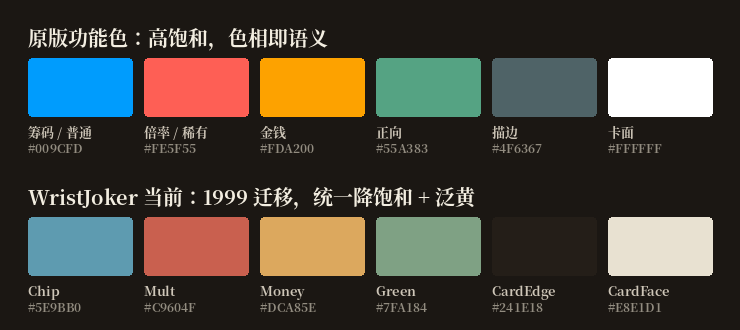
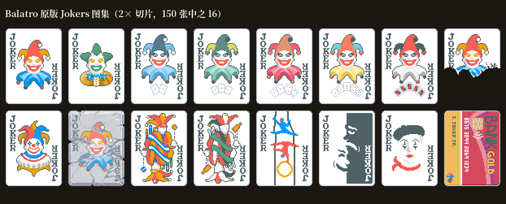

# 原版对照审计（2026-11-21）

> 起因：用户给了一条第三方站的 Balatro Android APK 直链，说「看看」。
> 结论先放：**那条链接已经失效**；但顺着包名找到了同源的原始素材，做了第一轮能落到代码上的对照。
>
> 与 `GAP_VS_ORIGINAL.md` 的分工：那份讲「原版有的功能我们没做」，这份只讲**拿原版素材实测出来的数**：「哪些数值本来就对、哪些文案和规则对不上」。

## 1. 那条链接是什么

包名 `com.playstack.balatro.android`，是 Balatro 的官方 Android 版（Playstack 发行，LocalThunk 开发）。链接本身是带签名参数的 CDN 直链，形态是「`time` + `key` + `wsrid_tag`」的临时授权。

实际请求结果：

| 步骤 | 结果 |
|---|---|
| 首次 GET（跟 302） | `HTTP 200`，`Content-Type: text/html`，**621 字节** |
| 响应体 | `<meta http-equiv="refresh" content="2;URL=https://m.downkuai.com?to">` + 「跳转到当快软件园」 |
| 补 `Referer` 重试 | `302 → https://get.downkuai.com/location.html`，仍是同一张跳转页 |
| 换 UA / 换 Accept 重试 | 同上 |

也就是说签名校验没通过（大概率是 `key` 与 `time` 这一对已过期，或该 CDN 只认特定 UA + Cookie），服务器把请求退回站点的落地页。**拿不到 APK**。

顺带说一句：这类第三方站的二次打包 APK 不建议直接装 —— 签名被替换、可能夹带推广 SDK，存档也和你手上的正版不互通。

## 2. 替代取证：拿到同源素材

镜像站（apkpure / apkcombo / apkmirror）从这台机器全部不可达（`000` / Cloudflare 403）。改走 GitHub 上社区维护的资源仓库 `ns2250225/Balatro`（HTML5 移植版，内含原版 2× 图集、字体、数值表、六语言文本），只取比对需要的那部分：

| 文件 | 大小 | 用途 |
|---|---|---|
| `Jokers.png` | 1420×3040 | 150 张小丑，10 列 × 16 行，每张 142×190（2×） |
| `8BitDeck.png` | 1846×760 | 52 张牌面 + 牌背，13 列 × 4 行，每张 142×190 |
| `Enhancers.png` | 994×950 | 增强 / 蜡封 / 版本叠加层 |
| `chips.png` `BlindChips.png` `Vouchers.png` `boosters.png` | — | 筹码图标、盲注、优惠券、补充包 |
| `m6x11plus.ttf` | 34 KB | 原版像素字体（11px 高，字宽 6） |
| `P_CENTERS.json` `P_CARDS.json` `P_BLINDS.json` | — | 每个对象的稀有度 / 价格 / 图集坐标 / 解锁条件 |
| `loc_zh-CN.json` | 76 KB | **官方简体中文文案**（150 个小丑名与描述、13 种牌型、稀有度、标签、成就） |

素材只落在临时目录 `artifact/.../ref/`，没有进仓库、没有打进 APK —— 本项目是设计迁移不是复刻，用不到原版贴图。真正有用的是那张 `loc_zh-CN.json`。

## 3. 实测数据

**卡片几何（原版）**：71×95 @1×，圆角约 3px @1×，白卡面 `#FFFFFF`，深色描边 `#4F6367`，左右两侧竖排「JOKER」（右侧为镜像倒排）。稀有度直接写在**描边色**上。

**原版主色**（按面积占比，从图集采样）：

| 色值 | 占比 | 语义 |
|---|---|---|
| `#FFFFFF` | 32.0% | 卡面 |
| `#4F6367` | 8.6% | 描边 / 深色结构线 |
| `#BFC7D5` | 4.6% | 淡蓝灰（次级信息） |
| `#FD5F55` | 3.3% | 倍率 / 稀有 |
| `#009CFD` | 1.0% | 筹码 / 普通 |
| `#FDA200` | 0.8% | 金钱 |
| `#55A383` | — | 正向 / 罕见 |

我们的迁移版：`#5E9BB0` / `#C9604F` / `#DCA85E` / `#7FA184` —— 色相尽量贴近，饱和与明度各降一档。



## 4. 数值：对得上

| 项 | 原版 | 我们 | 结论 |
|---|---|---|---|
| 13 种牌型基础值 | 5/1、10/2、20/2、30/3、30/4、35/4、40/4、60/7、100/8、120/12、140/14、160/16 | 同 | ✅ |
| 盲注目标（Ante 1–8） | 300 / 800 / 2000 … ×1.6 递增 | 同表 | ✅ |
| 稀有度权重 | 70 / 25 / 5 | 同 | ✅ |
| 稀有度价格区间 | 1–6 / 4–8 / 7–10 | 同 | ✅ |

牌型和盲注这两层是准的。但小丑层不是 —— 稀有度与基础价都有偏差，见 §9.1、§9.2（那时只核了牌型/盲注，把小丑层的「价格取区间中位」当成了合理近似，实际是系统性偏移）。

## 5. 译名：47 条与官方不一致

官方中文里，小丑名大多带「小丑」后缀或用固定译法，我们不少是意译缩写。这不影响玩，但影响「这游戏是原版吗」的第一印象。完整清单：

| # | key | 我们的译名 | 官方译名 |
|---|---|---|---|
| 1 | `half` | 半个小丑 | 半张小丑 |
| 2 | `misprint` | 印错 | 印错小丑 |
| 3 | `mystic` | 神秘山顶 | 神秘之峰 |
| 4 | `scary` | 恐怖脸 | 恐怖面孔 |
| 5 | `smiley` | 笑脸 | 微笑表情 |
| 6 | `runner` | 跑者 | 跑步选手 |
| 7 | `square` | 方块小丑 | 方形小丑 |
| 8 | `flash` | 闪电牌 | 闪示卡 |
| 9 | `sly` | 狡猾小丑 | 奸诈小丑 |
| 10 | `wily` | 诡计小丑 | 狡猾小丑 |
| 11 | `clever` | 精明小丑 | 聪敏小丑 |
| 12 | `devious` | 狡诈小丑 | 阴险小丑 |
| 13 | `crafty` | 精巧小丑 | 精明小丑 |
| 14 | `jolly` | 欢乐小丑 | 开心小丑 |
| 15 | `zany` | 疯狂小丑 | 古怪小丑 |
| 16 | `mad` | 狂热小丑 | 疯狂小丑 |
| 17 | `crazy` | 癫狂小丑 | 狂野小丑 |
| 18 | `mime` | 默剧 | 哑剧演员 |
| 19 | `obelisk` | 方尖碑 | 方尖石塔 |
| 20 | `family` | 家族 | 一家人 |
| 21 | `tribe` | 部族 | 部落 |
| 22 | `stencil` | 模板小丑 | 模具小丑 |
| 23 | `loyalty` | 忠诚卡 | 积分卡 |
| 24 | `golden` | 金券 | 黄金小丑 |
| 25 | `parking` | 预留车位 | 私人车位 |
| 26 | `bull` | 公牛 | 斗牛 |
| 27 | `ticket` | 门票 | 黄金门票 |
| 28 | `faceless` | 无面 | 无面小丑 |
| 29 | `smeared` | 涂抹 | 模糊小丑 |
| 30 | `pareidolia` | 幻想性错觉 | 幻视 |
| 31 | `hack` | 黑客 | 烂脱口秀演员 |
| 32 | `troubadour` | 吟游诗人 | 游吟诗人 |
| 33 | `marble` | 大理石 | 大理石小丑 |
| 34 | `egg` | 蛋 | 鸡蛋 |
| 35 | `juggler` | 杂耍者 | 杂耍师 |
| 36 | `perkeo` | 佩尔克 | 帕奇欧 |
| 37 | `ancient` | 远古 | 古老小丑 |
| 38 | `hologram` | 全息图 | 全息影像 |
| 39 | `splash` | 水花 | 飞溅 |
| 40 | `drunkard` | 酒鬼 | 醉汉 |
| 41 | `luchador` | 摔角手 | 摔跤手 |
| 42 | `throwback` | 回顾 | 回溯 |
| 43 | `cartomancer` | 纸牌师 | 卡牌术士 |
| 44 | `burnt` | 烧焦 | 烧焦小丑 |
| 45 | `seance` | 降神 | 通灵 |
| 46 | `superposition` | 叠加 | 叠加态 |
| 47 | `oops` | 全是 6 | 六六大顺 |

150 个里有 93 个 key 与官方同名，另 57 个用了缩写或改写（`even`→`even_steven`、`fib`→`fibonacci`、`icecream`→`ice_cream`、`ridebus`→`ride_the_bus`…）。这一层只影响后续对表，玩家看不到，但要做「译名自动同步」就得先补一张别名表。

## 6. 语义：6 条实现与官方规则不符

这一类比译名重要 —— 玩家如果玩过原版，会觉得「这牌不是这么用的」。逐条对照官方描述与我们 `Joker.kt` 里的实现：

| 小丑 | 官方规则（`loc_zh-CN.json` 原文） | 我们的实现 | 位置 |
|---|---|---|---|
| **超新星** | 将牌型在本赛局内被打出过的次数添加至倍率 | `it.level * 4` —— 用的是**牌型等级**，不是打出次数 | `Joker.kt:222` |
| **黄金小丑** | 在回合结束时获得 $4 | `scoring.count { it.enh == GOLD } * 4` —— 变成「每张黄金牌 +$4」 | `Joker.kt:357` |
| **古老小丑** | 打出的**某一种**花色在计分时给予 ×1.5，回合结束时改变需求花色 | `1.0 + 0.5 × 花色种类数` —— 变成「花色越多倍率越高」 | `Joker.kt:432` |
| **方尖石塔** | 连续打出不是你最常用的牌型时 ×0.2，失败重置 | 牌型序号 ≥ 同花就给 ×2 —— 完全另一套 | `Joker.kt:318` |
| **仪式匕首** | 摧毁**右侧**的小丑，其售价的两倍永久加到倍率 | 描述写「卖出时吞掉**左侧**小丑」，方向反了，机制也不同 | `Joker.kt:473` |
| **全息影像** | 每添加一张卡牌到牌组 ×0.25（塔罗、星球加的牌也算） | 只统计「商店买小丑」的次数 | `Joker.kt:438` |

其中 **超新星** 是最容易被老玩家一眼看穿的：原版它是「打的次数越多倍率越高」的累积型，我们做成了跟牌型等级挂钩，前期弱后期爆炸，节奏完全不同。

修这 6 条要动 `ScoreContext` 的字段（牌型打出次数、金币触发时机、需求花色），其中前两项还会影响存档格式（`SaveCodec` 的 v2 追加行），不是纯文案改动。

## 7. 视觉：差距在哪、哪些不算差距



原版卡片信息密度很低：白底、一张插画、左右两个竖排 JOKER，稀有度只靠边框色。我们的小丑卡是米黄纸 + 墨黑描边 + 衬线数字 + 角标徽记 —— 这是 1999 迁移的**有意选择**，不算落后。

真正值得抄的一点是：**原版用描边色承担稀有度**，五米外就能分辨。我们目前稀有度只体现在角上的小色块（`JokerBadge` 的 `accent`），在 18dp 的行高里几乎看不见。

## 8. 建议（按性价比排）

1. **译名批量对齐官方 47 条** —— 纯字符串替换，零逻辑风险，改完「像不像原版」的观感提升最直接。唯一要验的是长名（`烂脱口秀演员` 6 字）在 18dp 行里的截断。
2. **稀有线加粗到描边** —— 小丑卡边框按稀有度上色（我们已有 `rarityColorOf()`），宽度 1dp，比现在的角标显眼得多，改动只在 `JokerBadge`。
3. **修 6 条语义** —— 要动引擎与存档，建议单独一轮，改完跑 162 个单测 + 补 6 个针对性的用例。
4. 不做：搬原版像素贴图、换 m6x11 字体。前者会毁掉现有设计语言，后者没有中文字形。

## 9. 第二轮：第二条链接拿到了真 APK

同一天稍晚，用户给了一条更短的链接（去掉了 `wsiphost`/`wsrid_tag` 那一串），这次成了：

| 项 | 值 |
|---|---|
| 响应 | `200`，`application/vnd.android.package-archive` |
| 体积 | 63,516,204 字节 |
| 版本 | `1.0.1o-FULL [M]`，Android 包 `12.11.0`（构建于 2026-09-09） |
| 关键 | `assets/` 下是**未编译的 Lua 源码**：`card.lua` 251 KB、`game.lua`、`blind.lua`、`ui.lua`、14 种语言的 `localization/*.lua` |

有源码在手，上一轮「靠官方文本推断」的结论就可以逐条落实。三处需要修正。

### 9.1 稀有度：10 处标错（已修）

| 小丑 | 我们 | 原版 |
|---|---|---|
| 偶数史蒂文 `even` | 罕见 | **普通** |
| 奇数托德 `odd` | 罕见 | **普通** |
| 备用长裤 `trousers` | 普通 | **罕见** |
| 粗糙宝石 `rough` | 普通 | **罕见** |
| 黑板 `blackboard` | 稀有 | **罕见** |
| 金券 `golden` | 罕见 | **普通** |
| 挂饰 `hanging` | 罕见 | **普通** |
| 小小丑 `wee` | 罕见 | **稀有** |
| 烧焦 `burnt` | 罕见 | **稀有** |
| 全是 6 `oops` | 普通 | **罕见** |

稀有度不只是标签 —— 它决定商店出现权重（70/25/5），标错等于把这张牌的实际强度调了一档。

### 9.2 基础价：14 处偏差（已修）

原版每个小丑的 `cost` 是写死的整数；我们用的是「稀有度区间取中位」去猜，于是系统性偏移。已按 `game.lua` 的 `cost` 逐条改回：`sly` 3→4、`blackboard` 7→6、`campfire` 8→9、`wee` 6→8、`stuntman` 8→7、`merry` 6→7、`hiker` 6→5、`flash` 6→5、`swash` 6→4、`hologram` 6→7、`luchador` 7→5、`hanging` 6→4、`parking` 5→6、`trousers` 5→6。

### 9.3 小丑池不是官方的 150 张

数量都是 150，但内容不等价：

- **自创 5 条**：`barrier` 屏障（万能牌 +2 倍率）、`raisin` 提子干（手中 A +7 倍率）、`surefire` 必中（红桃 +$1）、`sad` 悲伤小丑（黑桃 +12 倍率）、`golden` 金券（黄金牌 +$4）—— 官方没有这五条规则。
- **重复 1 条**：`golden` 与 `goldjoker` 都指向官方的 `j_golden`（Golden Joker，回合结束 +$4），而两条的实现都不对。
- **官方缺 6 张**：`hit_the_road` 上路吧杰克、`idol` 偶像、`lucky_cat` 招财猫、`midas_mask` 迈达斯面具、`ring_master` 马戏团长、`seeing_double` 重影。

所以「150 个小丑」这个数字对得上，池子其实差 6 张、多 5 张。

### 9.4 实现偏差远不止 6 条

原先那 6 条是从「官方描述文本 vs 我们的 desc」比出来的。读了 `card.lua` 之后随手抽 5 条，全都不对：

| 小丑 | 官方（`card.lua` 实现） | 我们 |
|---|---|---|
| 六六大顺 `oops` | 所有带数字标注的**概率翻倍** | 「每张 6 +6 倍率」—— 完全另一张牌 |
| 徒步者 `hiker` | 打出的每张牌**永久** +5 筹码 | 「×1.5 倍率」 |
| 驾驶执照 `driver` | 牌组里有 16 张增强牌时 ×3 | 「每张增强牌 ×0.15」 |
| 特技演员 `stuntman` | +250 筹码，手牌上限 -2 | 「×8 倍率」 |
| 未断选票 `hanging` | 第一张计分牌**额外触发 2 次** | 「首张人头牌 ×1.5」 |

这不是参数没调准，是**牌的规则本身不一样**。抽样命中率 5/5，说明 150 条里相当一部分是照着名字猜的效果，而不是照源码写的。

按这个比例估算，要做到「玩过原版的人不觉得别扭」，得把 145 条逐条对着 `card.lua` 重写一遍，而不是补几条。

### 9.5 超新星：源码确认

`card.lua:3734`：

```lua
if self.ability.name == 'Supernova' then
    return { message = ..., mult_mod = G.GAME.hands[context.scoring_name].played }
end
```

`G.GAME.hands[...].played` 是**该牌型本局被打出的次数**，跟牌型等级无关。我们写的是 `it.level * 4`，确认错了。

### 9.6 字体：原版本身就是混排

`game.lua:937–945` 的字体表：

| 字体 | 用途 | FONTSCALE |
|---|---|---|
| `m6x11plus.ttf` | 拉丁字母与数字 | 0.1 |
| `NotoSansSC-Bold.ttf` | 简体中文 | 0.36 |

也就是说 Balatro 从来不是「全像素」：**像素只用在数字和拉丁文上，中文一律无衬线**。

这条对设计取舍有用 —— 想接原版的血统，正确的做法不是把整个界面像素化，而是把**数字与英文标签**换成像素字，中文保持系统字。两套字并存恰好是原版的原始形态。

### 9.7 状态

| 项 | 状态 |
|---|---|
| 稀有度 10 处 | ✅ 已改，172 个单测通过 |
| 基础价 14 处 | ✅ 已改 |
| 47 条译名 | ✅ 已对齐（实际改名 38 条，其余为 key 别名差异） |
| 补齐官方缺失小丑 | ✅ 已补 5 张（上路吧杰克 / 偶像 / 招财猫 / 迈达斯面具 / 重影），`showman` 更名为「马戏团长」对应原版 `j_ring_master` |
| 5 张自创小丑 | ✅ 已删（屏障 / 提子干 / 必中 / 悲伤小丑 / 金券与金小丑重复） |
| 黄金小丑 | ✅ 改为回合结束 +$4（`CashOutDetail` 增 `jokerBonus` 字段） |
| 6 条语义偏差 | ⚠️ 黄金小丑已改；超新星 / 古老小丑 / 方尖石塔 / 仪式匕首 / 全息影像仍待重写（需要「成长计数器」这类有状态机制，超出当前纯函数计分框架） |
| 小丑头像 | ✅ 由「按 id 哈希随机像素脸」改为「按效果分类的矢量徽记」（筹码堆 / 加号 / 叉号 / 硬币 / 三叶草 / 扑克牌 / 红桃 / 箭头 / 皇冠 / 帽子） |

**已知的近似**：上路吧杰克、偶像、招财猫在原版都是**有状态**的（本回合弃牌计数、每回合随机点数、幸运触发永久成长）。当前计分框架是只读快照（`ScoreContext` 注释明示「小丑效果不可改变游戏状态」），所以这三张先按「每弃一张 +0.5 / 按底注选点数 ×2 / 每张幸运牌 ×1.25」做了静态近似，等「成长计数器」落地后再对齐。重影、迈达斯面具是纯函数，已按原版规则实现。

## 附：取证命令

```bash
# 直链
curl -sIL -A "Mozilla/5.0 (Linux; Android 13)" "<原始链接>" | grep -iE "^HTTP|location"
# → 302 → https://get.downkuai.com/location.html

# 素材（走 jsdelivr，GitHub 直连只有 0.6 KB/s）
curl -sL -o Jokers.png \
  https://cdn.jsdelivr.net/gh/ns2250225/Balatro@main/assets/images/Jokers.png
```
